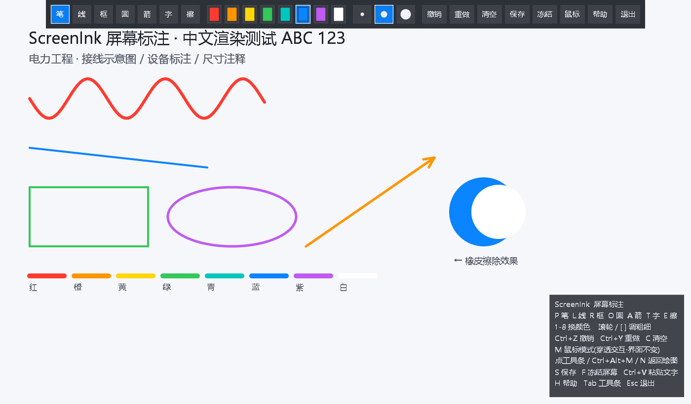

# ScreenInk — Annotation d'écran

[English](README.md) · [简体中文](README.zh-CN.md) · [繁體中文](README.zh-TW.md) · [日本語](README.ja.md) · [Deutsch](README.de.md) · [Español](README.es.md) · **Français**

Outil d'annotation / dessin d'écran mono-fichier pour Windows. Implémenté en Rust pur avec [`windows-sys`](https://crates.io/crates/windows-sys) ; la superposition plein écran est dessinée par le programme lui-même, sans framework GUI tiers ni installation : un simple exécutable suffit.



## Fonctionnalités

- **Annotation en superposition plein écran** sur tout le bureau virtuel (multi-écrans pris en charge), sans perturber les fenêtres en dessous
- **Sept outils** : stylet à main levée, ligne, rectangle, ovale, flèche, texte et gomme
- **8 couleurs × 3 épaisseurs** ; le texte propose 3 tailles et accepte le collage avec `Ctrl+V`
- **Annuler / rétablir / effacer**, avec jusqu'à 50 étapes d'historique
- **Figer l'écran (`F`)** : capture une image fixe sur laquelle annoter, idéal pour expliquer un contenu dynamique
- **Mode souris avec clic traversant (`M`)** : rend la saisie à l'application sous-jacente ; revenez à tout moment via le raccourci global ou la barre d'outils
- **Interface en 7 langues** : English, 简体中文, 繁體中文, 日本語, Deutsch, Español, Français. La langue de Windows est détectée au démarrage (repli sur l'anglais) ; changez-en à tout moment avec le bouton de langue de la barre d'outils
- **Enregistrement PNG en un clic** sur le Bureau, avec un nom de fichier horodaté
- **Mono-fichier, CRT liée statiquement** : aucune dépendance à l'exécutable VC++, taille réduite, prêt à copier et utiliser

## Raccourcis

| Catégorie | Touche | Action |
| --- | --- | --- |
| Outils | `P` `L` `R` `O` `A` `T` `E` | Stylet / Ligne / Rect / Ovale / Flèche / Texte / Gomme |
| Couleur | `1` – `8` | Changer parmi les 8 couleurs |
| Épaisseur | Molette ou `[` `]` | Plus fin / plus épais |
| Édition | `Ctrl+Z` / `Ctrl+Y` / `C` | Annuler / rétablir / effacer |
| Fichier | `S` (ou `Ctrl+S`) | Enregistrer un PNG sur le Bureau |
| Affichage | `F` | Figer / libérer l'écran |
| Clic traversant | `M` | Activer le mode souris |
| Retour | `Ctrl+Alt+M` / `Ctrl+Alt+N` | Raccourci global pour quitter le mode souris et redessiner |
| Divers | `H` / `F1` | Afficher ou masquer la carte d'aide |
| Divers | `Tab` | Afficher ou masquer la barre d'outils |
| Texte | `Entrée` / `Échap` / `Ctrl+V` | Confirmer / annuler / coller |
| Langue | Bouton de langue dans la barre | Parcourir les 7 langues de l'interface |
| Quitter | `Échap` | Fermer le programme |

## Utilisation

Double-cliquez sur `ScreenInk.exe` et commencez à annoter ; appuyez sur `Échap` pour quitter. Les images enregistrées vont sur le **Bureau** avec des noms comme `ScreenInk_20261105_173000.png`.

## Compiler depuis les sources

Nécessite la chaîne d'outils Rust (cible MSVC) :

```bash
cargo build --release
```

Le binaire se trouve dans `target/release/screenink.exe` (le `ScreenInk.exe` à la racine du dépôt en est une copie renommée). `.cargo/config.toml` active `+crt-static` pour lier la CRT statiquement, et le profil release est optimisé pour la taille (LTO + `opt-level="z"` + `strip`).

Auto-test du pipeline de rendu (n'ouvre pas de fenêtre ; génère `selftest.png`, y compris les 7 barres d'outils localisées) :

```bash
cargo run -- --selftest
```

## Structure du projet

| Fichier | Rôle |
| --- | --- |
| `src/main.rs` | Création de la fenêtre, boucle de messages, raccourcis globaux et orchestration des interactions |
| `src/i18n.rs` | Énumération des langues et tables de textes en 7 langues |
| `src/ui.rs` | Barre d'outils supérieure et carte d'aide dessinées à la main |
| `src/raster.rs` | Tampon de pixels, canevas et rastérisation des formes |
| `src/capture.rs` | Capture d'écran (fond figé) |
| `src/text.rs` | Rendu du texte avec des polices selon la langue |
| `src/png.rs` | Encodage et enregistrement PNG |

## 💛 Soutenir le développement

ScreenInk est un logiciel libre et open source. S'il vous aide vraiment dans votre travail, offrez-moi volontiers un café ☕.

<div align="center">
  
  <p>Scannez avec <b>Alipay</b> pour laisser un pourboire</p>
</div>

> Les pourboires sont entièrement volontaires et n'affectent aucune fonctionnalité. Merci pour votre soutien et vos encouragements !
